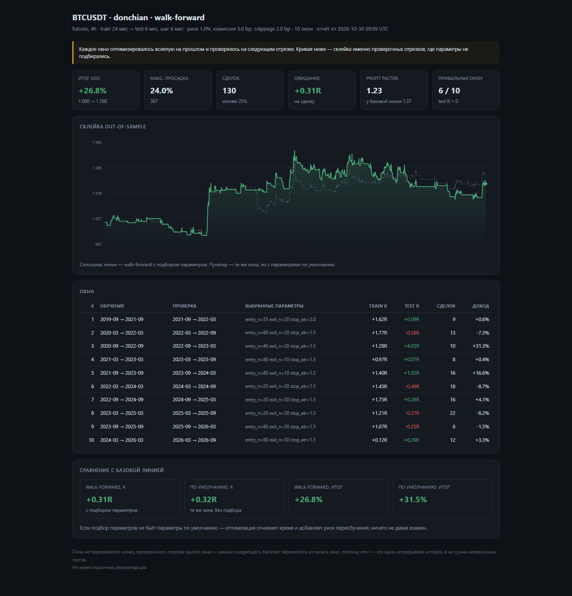
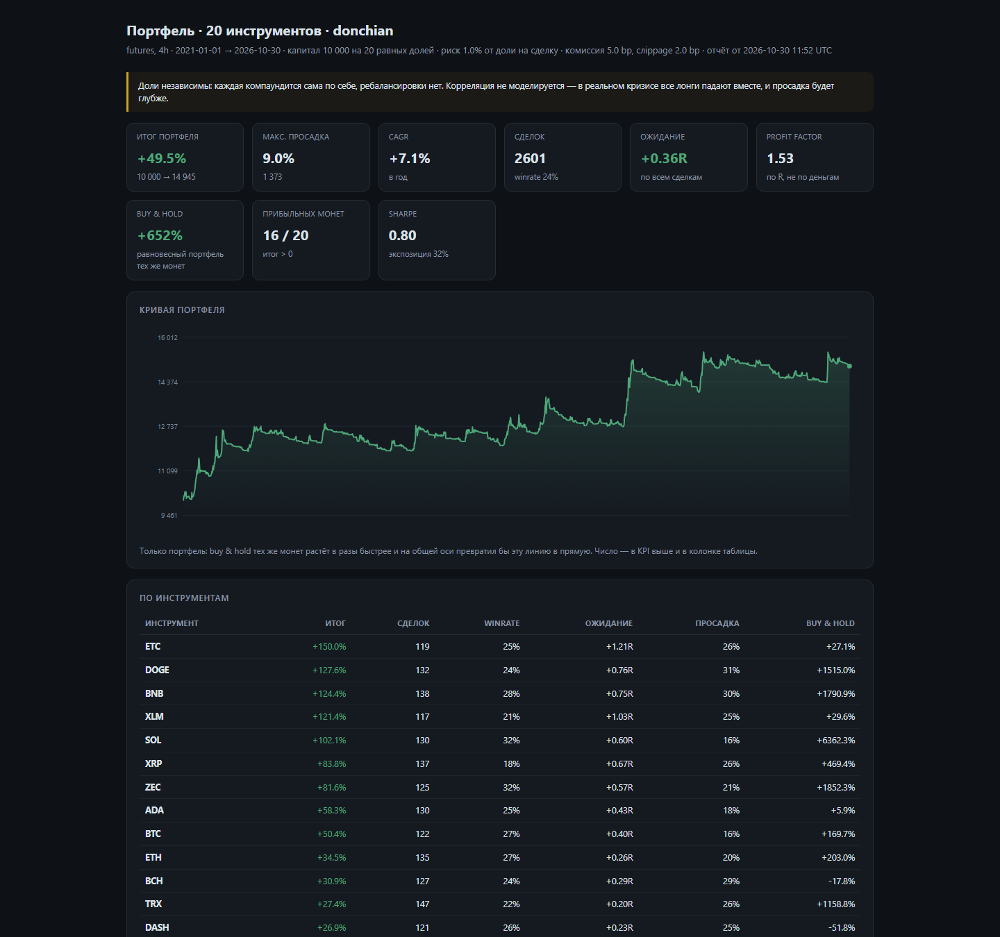

# Риск и журнал

Локальный инструмент для торговли криптой: калькулятор размера позиции и журнал сделок со статистикой. Один HTML-файл, работает офлайн, без аккаунта на бирже, без API-ключей и без интернета.

## Как открыть

1. Двойной щелчок по `risk-journal.html` (или перетащите файл в окно Chrome / Edge / Firefox).
2. Всё. Никакой установки, сервера и регистрации.

Проверено на Chrome. Данные сохраняются в браузере автоматически.

## Зачем это нужно

Новичок теряет депозит не из-за «неправильного прогноза», а из-за размера позиции и отсутствия статистики. Этот файл закрывает две вещи:

- **Калькулятор** считает размер позиции от стоп-лосса, а не «на глазок». Показывает реальный риск с комиссиями и предупреждает о типичных ошибках.
- **Журнал** превращает сделки в цифры: winrate, ожидание в R, profit factor, просадка. Через 50 сделок видно, что работает, а что нет.

## Калькулятор

Входные данные: депозит, риск на сделку (%), плечо, комиссия за сторону, направление, цена входа, стоп, тейк (необязательно).

Формулы:

```
риск в $       = депозит × риск%
размер позиции = риск в $ / |вход − стоп|
стоимость      = размер × вход
маржа          = стоимость / плечо
комиссии       = стоимость × комиссия% × 2
реальный риск  = риск в $ + комиссии
R:R            = (прибыль при тейке − комиссии) / реальный риск
```

Предупреждения:

- стоп с неверной стороны от входа;
- риск выше 2% на сделку;
- стоп ближе 0.35% (шум выбьет);
- издержки съедают больше 30% риска;
- стоп дальше расчётной цены ликвидации при выбранном плече;
- размер позиции больше доступной маржи;
- R:R меньше 1 (и какой winrate тогда нужен).

## Журнал

Поля сделки: дата, инструмент, направление, сетап, вход, стоп, размер, выход, комиссия, заметка.

- Выход пустой → сделка считается открытой.
- Комиссия пустая → считается автоматически (комиссия из калькулятора × оборот).
- Кнопка «Взять из калькулятора» переносит расчёт в форму.
- ✎ — редактировать (там же закрыть открытую сделку), ✕ — удалить.

**R** = результат в единицах риска: `PnL / (|вход − стоп| × размер + комиссии)`. Риск $50, прибыль $100 → +2R. Считать в R важно: это качество решения, а не размер депозита.

## Статистика

- **Winrate** — доля прибыльных. Сама по себе бесполезна.
- **Ожидание, R** — средний результат сделки в R. Это и есть «край». +0.2R значит, что каждая сделка в среднем приносит 0.2 риска.
- **Profit factor** — сумма прибылей / сумма убытков. Ниже 1.0 — теряете.
- **Просадка** — падение от максимума, то, что придётся пережить.
- Разбивка по сетапам и инструментам — где реально зарабатываете.

Кнопка **«Пример»** загружает 21 демо-сделку (реалистичный профиль: 40% winrate, +0.31R ожидание, PF 1.62, просадка 4.3%, серия из 4 убытков) — чтобы посмотреть, как это выглядит до собственных данных.

## Данные и бэкап

- Хранение: `localStorage` браузера, привязан к пути файла. **Не переименовывайте и не перемещайте файл** — иначе браузер будет считать это новым документом, и данные «пропадут» (останутся по старому пути).
- **Экспорт** — JSON со всеми сделками, **CSV** — для таблиц, **Импорт** — восстановление из JSON.
- Очистка кэша браузера удаляет данные. Экспорт — единственная защита.
- Один файл = одно устройство. Синхронизации между устройствами нет.

## Ограничения

- Нет загрузки цен с биржи: цены вводятся вручную. Сделки не подтягиваются из API.
- Нет учёта funding rate, спреда и проскальзывания — только комиссии.
- Нет мультивалютного портфеля и налогообложения.
- Не торгует. Ничего не выставляет на биржу.

## Лаборатория: данные и бэктест

Второй инструмент — папка `lab/`. Публичные API Binance (без ключей), SQLite, честный бэктест.

### Запуск

Нужен Python 3.10+ с `pandas` и `numpy`.

```bash
cd crypto-tools

# скачать историю: свечи + ставки финансирования
python -m lab.collect --symbol BTCUSDT --tf 4h --market futures --start 2019-01-01 --funding

# что уже в базе
python -m lab.collect --status

# прогнать стратегию и получить HTML-отчёт
python -m lab.run --symbol BTCUSDT --tf 4h --strategy donchian --split 0.7 \
    --report reports/btc-donchian.html

# проверить, что движок не врёт
python -m lab.selftest
```

### Модули

| Файл | Что делает |
|---|---|
| `lab/store.py` | SQLite: свечи (symbol/market/tf) и funding |
| `lab/collect.py` | загрузка с Binance: пагинация, ретраи, инкремент, добивка ранней истории |
| `lab/engine.py` | бар-за-баром: вход по следующему открытию, стоп внутри бара, комиссии, слippage, funding |
| `lab/strategies.py` | `sma` (пересечение средних), `donchian` (пробой канала), `rsi` (возврат к среднему) |
| `lab/metrics.py` | доходность, CAGR, просадка, Sharpe, winrate, ожидание в R, PF |
| `lab/report.py` | самодостаточный HTML-отчёт с кривой капитала |
| `lab/selftest.py` | 8 проверок движка на синтетике |

### Правила честности

- Сигнал считается по закрытию бара и исполняется по **открытию следующего**. Иначе look-ahead.
- Комиссия и слippage — на каждой стороне, всегда против нас.
- Стоп проверяется внутри бара; если бар открылся за стопом, выход по открытию (убыток может быть больше 1R — это правда жизни, а не баг).
- Если в одном баре задеты стоп и тейк, считаем, что первым сработал стоп.
- Funding списывается по фактическим ставкам из истории.
- Итог делится на in-sample и out-of-sample: вторая половина не участвовала в выборе параметров.

### Что показали прогоны

BTCUSDT, фьючерсы, 4h, 2019-09 → 2026-10, риск 1% на сделку, комиссия 5 bp, слippage 2 bp:

| Стратегия | Итог | CAGR | Просадка | Сделок | Winrate | Ожидание (IS) | Ожидание (OOS) | PF (OOS) |
|---|---|---|---|---|---|---|---|---|
| donchian | +152% | 13.8% | 21.9% | 140 | 29% | +1.07R | +0.14R | 1.18 |
| sma | +90% | 9.4% | 23.7% | 280 | 31% | +0.28R | +0.20R | 1.30 |
| rsi | −18% | −2.8% | 26.3% | 250 | 42% | −0.07R | — | 0.86 |

Для сравнения buy & hold за тот же период: +681% при просадке до −77%.

Выводы, которые важнее самих цифр:

1. **Заглядывание в будущее — главный источник фантазий.** Ожидание падает с +1.07R до +0.14R при переходе на out-of-sample. Это нормальная деградация, а не катастрофа.
2. **Издержки — не мелочь.** За 7 лет комиссии и funding съели у donchian ~$350 из $1 000 начального капитала. На минутках это убивает любую частую стратегию.
3. **Трендовые системы проигрывают buy & hold по доходности, но выигрывают по просадке** (22% против 77%) и находятся в рынке лишь 35% времени.
4. **Winrate 29% — не признак плохой стратегии.** При среднем выигрыше в 5 раз больше среднего проигрыша это работает. Смотреть надо на ожидание в R, а не на процент побед.
5. **Серия из 11 убытков подряд** — реальность, которую надо пережить, а не сигнал «сломать систему».

### Walk-forward

Половина истории — слишком грубая проверка. Walk-forward катит окно: оптимизирует параметры на `train` месяцах, проверяет на следующих `test` месяцах, сдвигается на `step` и повторяет. Проверочные отрезки не пересекаются и склеиваются в одну кривую капитала с переносом капитала между окнами.

```bash
python -m lab.walkforward --symbol BTCUSDT --tf 4h --strategy donchian \
    --train-months 24 --test-months 6 --step-months 6 \
    --report reports/wf-donchian.html
```

Грид перебирается на train по ожиданию в R (минимум 8 сделок), лучший набор проверяется на test. Параллельно на тех же test-окнах считается базовая линия — параметры по умолчанию. Смысл сравнения: понять, даёт ли подбор параметров хоть что-то, кроме шума.

Результаты, 10 окон, 2021-09 → 2026-09:

| Стратегия | Итог WF | Просадка | Ожидание WF | PF WF | Базовая линия | Прибыльных окон |
|---|---|---|---|---|---|---|
| donchian | +26.8% | 24.0% | +0.31R | 1.23 | +31.5% / +0.32R | 6 / 10 |
| sma | +37.8% | 29.4% | +0.42R | 1.37 | +17.5% / +0.12R | 6 / 10 |

Что видно:

1. **Край трендовых систем выживает.** Вне выборки обе стратегии в плюсе, ожидание +0.3…+0.4R. Это не грааль, но это не ноль.
2. **Оптимизация — лотерея.** У donchian подбор параметров сделал *хуже*, чем дефолтные значения (+0.31R против +0.32R). У sma — заметно лучше (+0.42R против +0.12R). Вывод не «оптимизировать полезно» и не «вредно», а «эффект неустойчив, поэтому оптимизацию надо проверять, а не предполагать».
3. **Train R всегда красивее test R.** В таблице окон видно, как +1.6R на обучении превращается в +0.09R на проверке. Именно эту разницу и прячут, когда показывают только бэктест.
4. **Просадка выросла** с 16–22% до 24–29%: склейка окон честнее одинарного прогона, потому что включает все плохие периоды, а не среднее по ним.



PPTX-подобной красоты здесь нет — и не надо: отчёт читают, чтобы принять решение «выкинуть или проверить дальше».

### Портфель: 20 инструментов, равный риск

Одна пара — одна история. Чтобы понять, край это или совпадение, то же правило гоняется по 20 ликвидным перпетуалам: капитал делится поровну, каждый sleeve торгует независимо, портфель — сумма кривых.

```bash
# данные по вселенной (один раз, ~2 минуты)
python -m lab.collect --symbol BTCUSDT ETHUSDT BNBUSDT SOLUSDT XRPUSDT ADAUSDT \
    DOGEUSDT DOTUSDT LINKUSDT LTCUSDT BCHUSDT ETCUSDT XLMUSDT TRXUSDT EOSUSDT \
    ATOMUSDT NEOUSDT DASHUSDT ZECUSDT XTZUSDT --tf 4h --funding

python -m lab.portfolio --strategy donchian --start 2021-01-01 \
    --capital 10000 --report reports/portfolio.html
```

Результаты, 2021-01 → 2026-10, капитал $10 000 на 20 равных долей:

| Стратегия | Итог | CAGR | Просадка | Sharpe | Сделок | Winrate | Ожидание | PF | Монет в плюсе |
|---|---|---|---|---|---|---|---|---|---|
| donchian | +49.5% | 7.1% | 9.0% | 0.80 | 2601 | 24% | +0.36R | 1.53 | 16 / 20 |
| sma | +55.3% | 7.8% | 13.8% | 0.72 | 4421 | 30% | +0.23R | 1.40 | 16 / 20 |

Равновесный buy & hold тех же 20 монет за тот же период: **+652%**.

Что это показывает:

1. **Край переносится на большинство инструментов** — 16 из 20 в плюсе, ожидание положительное у 17. Это уже статистика, а не везение на одной паре.
2. **Диверсификация режет просадку втрое**: 9% у портфеля против 22–24% у одиночного BTC. Именно за это платят управлением риском.
3. **Но доходность в 13 раз ниже buy & hold.** Трендовая система режет убытки (ATOM: −23% против −77% у B&H, DOT: −18% против −90%) и одновременно срезает большую часть роста (DOGE: +128% против +1515%). Это не баг, это профиль стратегии.
4. **Разброс между монетами огромен**: от +150% (ETC) до −24% (LTC) при одном и том же правиле. Выбор вселенной влияет почти так же сильно, как выбор стратегии.
5. **EOS делистингнут** в мае 2025 — sleeve просто перестал торговать. В реальности делистинг, смена контракта и ребрендинг монеты — отдельная головная боль, которой в бэктесте нет.



Важная оговорка: корреляция **не** моделируется. В реальном обвале все лонги падают вместе, поэтому настоящая просадка портфеля будет глубже 9% — ближе к 15–20%.

### Пейпер-трейдинг

Те же правила на живых данных, но без денег. Скрипт догоняет закрытые бары, ведёт виртуальные позиции, пишет журнал и события — и это одновременно алерты.

```bash
# старт с текущего бара
python -m lab.paper init --strategy donchian --capital 10000

# догнать историю с даты (проверка, что цикл работает)
python -m lab.paper init --strategy donchian --capital 5000 --from 2026-06-01 --force

python -m lab.paper step          # обработать новые закрытые бары
python -m lab.paper status --alerts
```

Что внутри:

- `step` идемпотентен: повторный запуск с теми же данными ничего не делает — курсор хранится в `paper/state.json`.
- Позиции открываются и закрываются по цене закрытия бара со слippage и комиссией, стоп срабатывает внутри бара, funding списывается по фактическим ставкам.
- Сделки пишутся в `paper/trades.csv`, события — в `paper/alerts.log`.
- Telegram: задайте `TELEGRAM_BOT_TOKEN` и `TELEGRAM_CHAT_ID` — те же события уйдут в чат.
- Всё в `paper/` — это данные, в git не попадает.

Автозапуск: `powershell -ExecutionPolicy Bypass -File .\install-paper-task.ps1` создаёт задачу в Планировщике Windows на каждый 15 минут. Лог — `paper/step.log`. Если Python не в PATH, задайте переменную `PYTHON` полным путём.

Проверка на истории (5 инструментов, с 2026-06-01): 4540 баров, 50 сделок, +3.93%, winrate 30%, ожидание +0.48R. Это не результат стратегии, а доказательство, что цикл, журнал и расчёты работают end-to-end.

Чем пейпер **отличается** от бэктеста:

- нет подгонки: бары приходят по одному, задним числом ничего не поправить;
- издержки те же, что в движке;
- но стакана нет: на тонких монетах реальное исполнение будет хуже;
- гэп через стоп здесь исполняется по цене стопа, а в жизни — по первой доступной.

И главное: пейпер проверяет **вас**, а не стратегию. 19 убытков подряд в отчёте и 19 убытков подряд на своём счёте — очень разные переживания.

### Живой дашборд

Смотреть на пейпер в терминале скучно, поэтому есть локальная страница:

```bash
python -m lab.serve --port 8765 --auto-step 300
# открыть http://127.0.0.1:8765
```

Сервер сам вызывает `step` каждые `--auto-step` секунд, страница перерисовывается раз в 10 секунд: капитал и доход, открытые позиции с текущей ценой и PnL, последние сделки, лента событий. Кнопка «Обновить сейчас» дёргает шаг вручную.

Всё слушает только `127.0.0.1` — наружу ничего не открыто. Остановить: закрыть процесс Python или `Ctrl+C` в консоли.

### Ограничения лаборатории

- Одна позиция на инструмент, без пирамидинга и частичных выходов.
- Funding учитывается только для фьючерсов; для спота его нет.
- Слippage — фиксированные bp, а не модель стакана: на крупных размерах реальность хуже.
- Walk-forward перебирает фиксированный грид, а не ищет оптимум байесовскими методами; окна train/test кратны месяцам.
- Портфель: доли независимы, корреляция и общий лимит маржи не моделируются.
- Выбор инструмента «выжившего»: BTC дожил до 2026-го, а половина альткоинов 2017 года — нет. Это завышает ожидания от любой стратегии.

## Что дальше (по плану)

1. ~~**Данные + бэктестер**~~ — сделано.
2. ~~**Walk-forward**~~ — сделано.
3. ~~**Портфель из нескольких инструментов**~~ — сделано.
4. ~~**Алерты**~~ — встроены в пейпер-трейдер (Telegram опционально).
5. ~~**Пейпер-трейдинг**~~ — сделано.
6. **Живой бот с guardrails** — только после месяца пейпера и лимитов: дневной убыток, число сделок, kill-switch.

## Дисклеймер

Инструмент для расчётов и дисциплины, не инвестиционная рекомендация. Большинство частных трейдеров теряют деньги, особенно с плечом. Ничего из этого не гарантирует прибыль.
